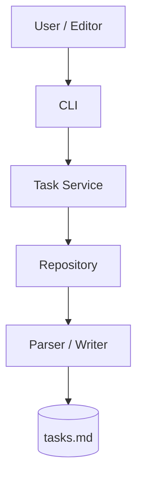
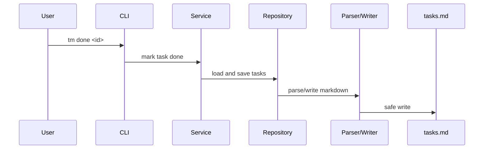

# TaskMD Lite — Minimal Architecture

## High-level shape

Lite is no longer a raw single file, but it is still intentionally compact.

## Read / write flow

## Why this is the right amount of structure

It gives the project:

- maintainable boundaries
- testable parser/writer logic
- clean packaging
- editor compatibility

without jumping into sidecars, connectors, or ecosystem features.
